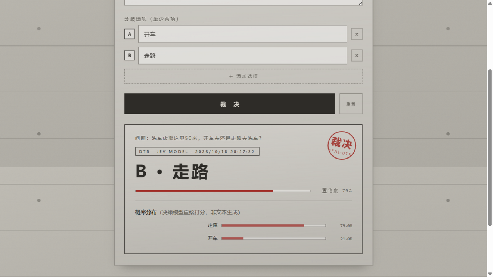

# 分歧终端解决器 DTR-01 · 清水混凝土

把选择困难症交给决策模型的单文件网页。输入一个问题和至少两个选项，它直接输出**带概率分布的裁决**——不生成解释文本，System One 风格。

**在线使用**：<https://slatinwine.github.io/dtr-01/>



## 它怎么裁决

四种模式，在页面底部「终端设置」里切换（配置自动存在浏览器本地）：

| 模式 | 接口 | 说明 |
|---|---|---|
| **jevy 本地蒸馏模型**（默认） | `POST /api/v1/decide` | [jevy](https://github.com/slatinwine/jevy)——118M 自炼 Jev 式决策模型，GTX 1650 即可跑，中英文原生 |
| Jev 决策接口 | `POST /v1/systemone` | TypeSafe AI 官方（`api.typesafe.ai`）或 Unsloth Laya 本地版，`answers` 契约 |
| Ollama | `POST /api/chat` | 走文本生成，要求模型只回一个 JSON |
| OpenAI 兼容 | `POST /v1/chat/completions` | 任何兼容端点（LM Studio / vLLM / 官方 API…） |

模型不可达时自动**离线兜底**：确定性哈希裁决（同一问题永远同一答案，仅供娱乐），所以页面在任何机器上打开都不会死。

## 接本地 jevy（推荐）

```bash
git clone https://github.com/slatinwine/jevy && cd jevy
# 从 Releases 下载 jevy-model.zip 解压为 model/
python jevy/intent_server.py --model-dir model --port 8767
```

页面默认配置就是 `http://127.0.0.1:8767`，起好服务直接点「裁决」即可。HTTPS 页面访问本机 `127.0.0.1` 属于浏览器允许的本地例外（Chrome / Edge / Firefox 均视 localhost 为可信源），无需额外设置；jevy 服务端已带 CORS 支持。

## 功能细节

- 概率分布条：决策模型（jevy / Jev 档）直接给出每个选项的打分，非文本生成
- 置信度进度条 + 印章式结果动画
- 选项数量随意增删，`Ctrl+Enter` 快捷裁决
- 浇筑进度条动画：模板支设 → 混凝土浇筑 → 振捣密实 → 养护凝固 → 拆模验收

## 技术与设计

零依赖单 HTML 文件。清水混凝土视觉语言：CSS 画的对拉螺栓孔、水平施工缝、SVG 骨料噪点，唯一强调色是印章红。

同系列：[mindmap](https://slatinwine.github.io/mindmap/) · [vi-editor](https://slatinwine.github.io/vi-editor/) · [retro-radio](https://slatinwine.github.io/retro-radio/) · [old-book-generator](https://slatinwine.github.io/old-book-generator/)

## License

MIT
